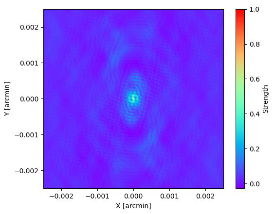
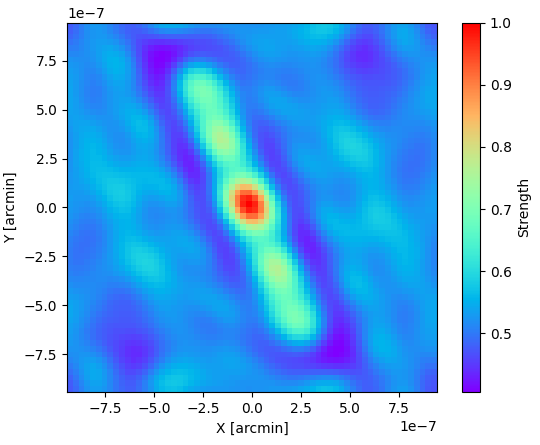
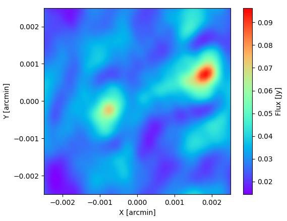

# Understanding the simulation results

[Project overview](../README.md) · [Run the scripts](../scripts/README.md) · [Original report](../docs/internship-report.pdf)

This directory holds outputs from the project's OmniUV simulations. Results connect a chosen **source model**, **array**, **frequency** and **observing schedule** to the spatial information sampled by the interferometer.

The key distinction is between an **input model**, a **dirty beam**, and a **dirty image**. They answer different questions and should be interpreted together with UV coverage.

## What each output means

| Product | Meaning | What to check |
|---|---|---|
| Input image or source-point plot | The brightness model supplied to the simulation, after the script's conversion. | Angular scale, recentering, orientation, crop and flux normalization. |
| Interpolated TXT model | A visual representation of discrete input positions and intensities. | Interpolation can make the display smoother without adding measured information. |
| UV coverage | Projected baseline samples, usually expressed in wavelengths or a stated multiple of them. | Radial extent, short baselines, gaps, direction coverage and units. |
| Dirty beam / PSF | The array's response to a point source under the chosen sampling and weighting. | Central-lobe size, elongation and sidelobes. |
| Dirty image | A reconstruction retaining the effects of incomplete UV sampling. | Distortions that can be explained by the beam; scaling and any added noise. |
| Resolution estimate | A characteristic angular scale based on wavelength and baseline or a beam measurement. | Definition, projected baseline, unit conversions and whether it is nominal or fitted. |
| `run_metadata.json` | A run-start record from the newer adapted wrappers. | Script/input hashes, command and timestamp; its presence does not prove completion. |

Output names vary across notebook-derived scripts. Existing examples include `Entrada_a_OmniUV_recentrado.png`, `Interpolacion_2D_recentrada.png`, `input_recortado.png`, and `sim_image_<frequency>MHz.png`. A filename describes a product, but its generating code determines its precise meaning. Integer-formatted frequency labels can also hide more precise frequency values.

## 1. Inspect the input first


*Report Figure 1: the TXT-derived jet model, displayed through interpolation.*

For **TXT inputs**, the adapted jet scripts read angular offsets in arcseconds and flux density per pixel. Recentring and cropping can change the coordinates and the part of the model that enters the calculation. Compare the raw model with the actual projected or cropped input, not just its original file.

For **PNG inputs**, grayscale intensities become model fluxes according to parameters inside the script. Image dimensions alone do not define sky coordinates or Jy. A rescaling, threshold or change in pixel count can change the integrated flux, especially if peak brightness rather than total flux is normalized.

The ring image used in the report is an illustrative morphology. Its use at a selected radio frequency does not include a validated spectral, opacity or scattering model for M87. Such a template is useful for testing the response to structure, but requires additional physical modelling before making observational claims.

## 2. Read UV coverage

| SLFRO-inspired configuration | Exploratory L2 configuration |
|---|---|
|  |  |

*Report Figures 7 and 8. The axis scales differ substantially.*

The coordinates $u$ and $v$ are projected baseline components measured in wavelengths. A physical baseline therefore moves farther from the origin when the observing frequency increases.

- **Large radius:** access to finer angular structure, provided the source has detectable correlated emission on those baselines.
- **Short baselines:** information about more extended structure.
- **Many orientations:** better constraints in different image directions.
- **Sparse tracks and large gaps:** missing information that can produce strong sidelobes and ambiguous structure.

Two arrays may have similar maximum baselines and very different beams. Likewise, an axis labelled in Mλ cannot be compared numerically with one labelled in km. Inspect the units and frequency before comparing plots.

## 3. Understand the dirty beam

| SLFRO-inspired beam | L2 beam |
|---|---|
|  |  |

*Report Figures 2 and 5. Compare their axes and normalizations before interpreting their apparent widths.*

The dirty beam is the point spread function associated with the sampled and weighted Fourier plane. Its central lobe indicates the effective angular response. Its sidelobes describe how a compact source can generate apparent features elsewhere in an image. An elongated central lobe indicates different resolving power in different directions.

A peak-normalized beam is usually dimensionless: its brightest value has been scaled to one. That color bar must not be interpreted as Jy. A rough $\lambda/B_\perp$ estimate and a fitted beam width are related measures, but they are not interchangeable.

## 4. Interpret the dirty image

| Jet reconstruction | Ring-template reconstruction |
|---|---|
|  |  |

*Report Figures 3 and 6. Figure 3's original caption repeats the beam label; the report's narrative identifies the reconstruction among these panels.*

In the small-field approximation, a useful interpretation is

$$I_{\mathrm{dirty}} \approx I_{\mathrm{model}} * B_{\mathrm{dirty}} + N,$$

where $*$ denotes convolution and $N$ represents any simulated noise. This description depends on the imaging assumptions. In particular, $N$ should not be assumed present unless the script actually adds it.

The image can contain blurred features, sidelobe structures, negative regions or missing extended emission. These need not be physical properties of the input source. A dirty image is not a deconvolved CLEAN image, and increasing the number of display pixels does not restore unmeasured spatial frequencies.

Check color-bar limits carefully. For example, the report's L2 reconstruction uses a narrow displayed intensity range; a visually prominent ring can represent a relatively small contrast. Auto-scaled panels can exaggerate differences or hide amplitude changes between runs.

## 5. Keep resolution, pixel size and field of view separate

For a square grid with $N$ pixels per side and angular pixel spacing $\Delta\theta$ in radians:

$$\mathrm{FoV} \approx N\Delta\theta, \qquad \Delta u \approx \frac{1}{\mathrm{FoV}}.$$

A regularly sampled FFT grid also has a finite represented UV range, approximately $|u| \lesssim 1/(2\Delta\theta)$ along each axis. Check the actual implementation's grid conventions and treatment of out-of-grid samples when choosing parameters.

| Quantity | Set mainly by | Does not establish by itself |
|---|---|---|
| Pixel spacing | Numerical grid choices | Physical resolving power. |
| Field of view | Pixel spacing and grid size | Faithful recovery of all extended emission. |
| Nominal angular resolution | Wavelength and projected baselines | Detectability or image fidelity. |
| Beam shape | UV sampling and weighting | A unique reconstruction of missing information. |
| Sensitivity | Station properties, bandwidth, integration and noise assumptions | Adequate angular coverage. |

Useful conversions: **1 arcsec = 1,000 mas; 1 mas = 1,000 µas; 1 arcmin = 60 arcsec**. Some report figures use arcmin with scientific-notation offsets, while others use mas or arcsec. Read both the axis label and its scale multiplier.

## 6. Connect a run to the report

The [internship report](../docs/internship-report.pdf) is an account of selected experiments, not a single frozen executable configuration.

| Report material | Interpretation |
|---|---|
| Mission overview, PDF page 7 | Historical and proposed configurations considered during the internship; verify hardware claims against current mission sources. |
| Resolution table, PDF page 7 | Values reported in the original analysis. Recheck definitions, units and parameters before quantitative reuse. |
| Figures 1–3, PDF page 8 | TXT jet example discussed at 1.4 GHz with an SLFRO-inspired configuration. |
| Figures 4–6, PDF page 9 | PNG ring-template demonstration discussed at 5 GHz with an L2 configuration. |
| Figures 7–8, PDF page 9 | UV-coverage comparison illustrating differences in extent and sampling. |

The current Lagrange script's frequency list is not necessarily the report's 5 GHz setup. A matching filename is insufficient to reproduce a figure. Record the precise frequency, stations, schedule, input scale, grid, weighting and noise settings. The report figures in `docs/images/` were extracted from the supplied PDF; they are **archival illustrations**, not newly executed benchmark results.

## 7. Compare scenarios fairly

For an array-geometry comparison, hold the source model, frequency, schedule, imaging grid, flux normalization and noise treatment fixed as far as practical. If a parameter changes deliberately, state it alongside the figure.

Read a comparison in this order:

1. Confirm the input model and its physical scale.
2. Check the actual stations added to the task and their visibility over the schedule.
3. Inspect UV extent and coverage at a common scale.
4. Compare beam size, elongation and sidelobes.
5. Compare dirty images using common axes and color limits where meaningful.
6. Distinguish geometric improvements from sensitivity changes and numerical effects.

For a frequency comparison, remember that changing frequency changes baselines in wavelengths. Reusing the same image at every frequency also imposes a source-model assumption; it does not simulate a source spectrum automatically.

## 8. Organize outputs and preserve provenance

The adapted wrappers normally write to a new timestamped directory under a scenario name. Keep run outputs separate from the source scripts. A suggested publication layout is:

```text
results/
    README.md
    selected/
        jet_comparison/
            uv_coverage.png
            dirty_beam.png
            dirty_image.png
            run-notes.md
    scenario_name/
        timestamp/
            run_metadata.json
            generated_figures...
```

This is an organizational example; actual filenames depend on the script. The `selected/` folder is for a small curated set of figures with captions. Large intermediate arrays and repeated exploratory images can remain local or be distributed as a separate archive.

A useful `run-notes.md` records:

```markdown
# Run record
- Script and repository revision:
- Local modifications:
- Input file, provenance and checksum:
- Command:
- Python and dependency versions:
- Actual station list and orbit assumptions:
- Observing frequency, bandwidth and integration:
- Source position and observing schedule:
- Field of view, grid and flux normalization:
- Imaging method, weighting and noise settings:
- Random seed, if controlled:
- Completion status and warnings:
- Main observation and limitations:
```

Use the wrapper's hashes to identify inputs, but supplement them with the scientific configuration and a completion record. Metadata written at startup cannot distinguish a complete run from one that later crashed, and not every earlier adaptation provides the same metadata fields.

## Scope of the conclusions

These simulations support exploration of the connection between array design and imaging. They do not, on their own, validate a proposed mission's engineering, establish an observing sensitivity budget, or demonstrate real-source detectability. The strongest conclusions are those supported jointly by the source assumptions, UV coverage, beam, noise model and a documented, successfully completed run.
