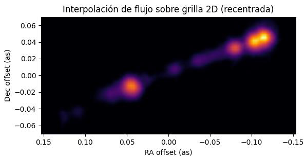
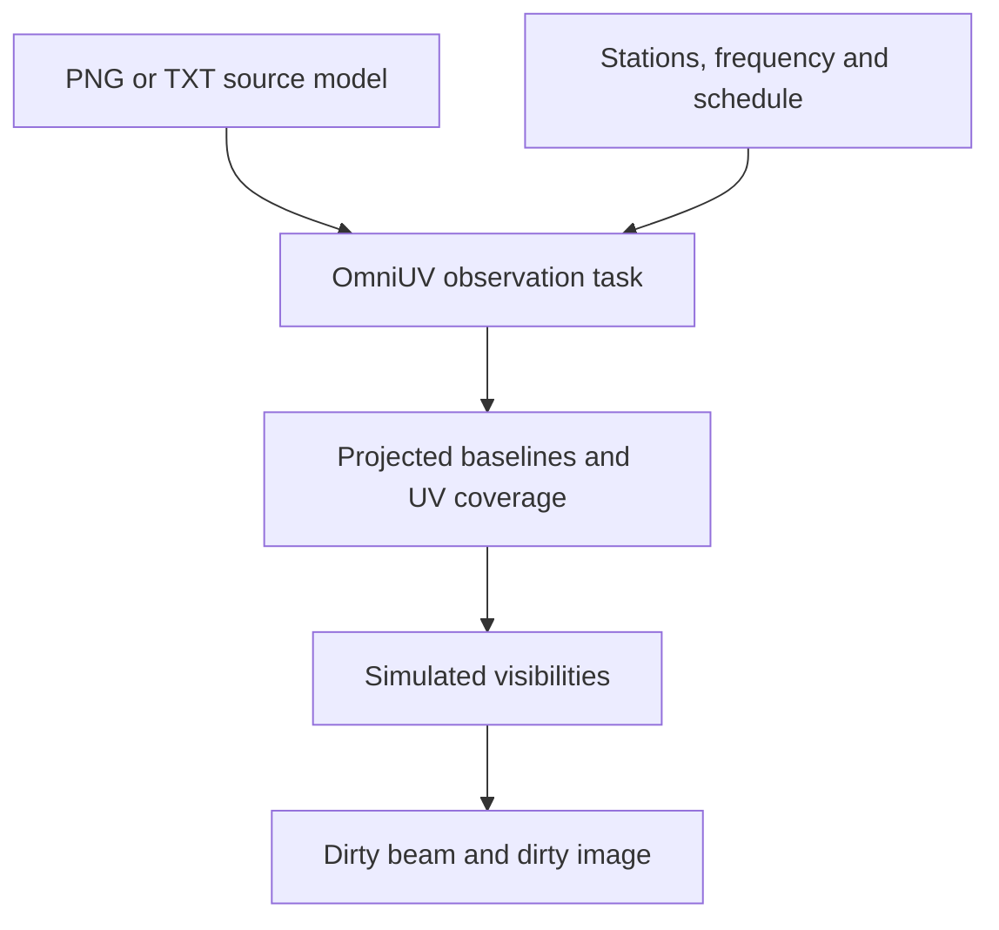
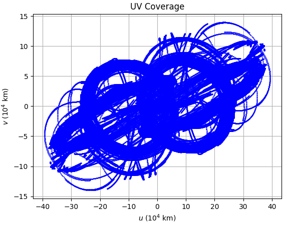
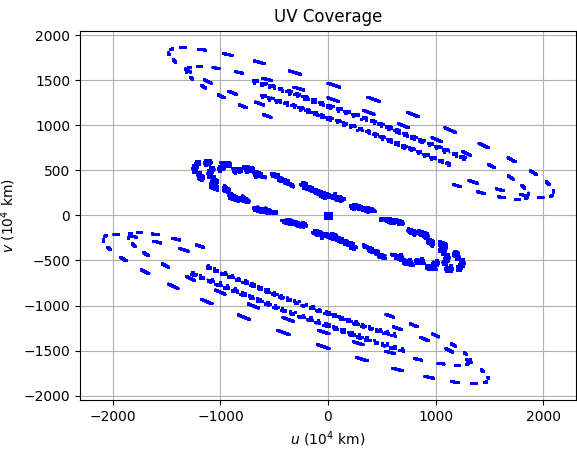
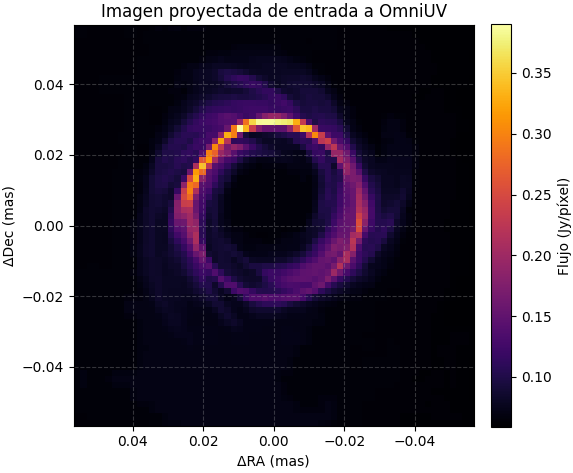
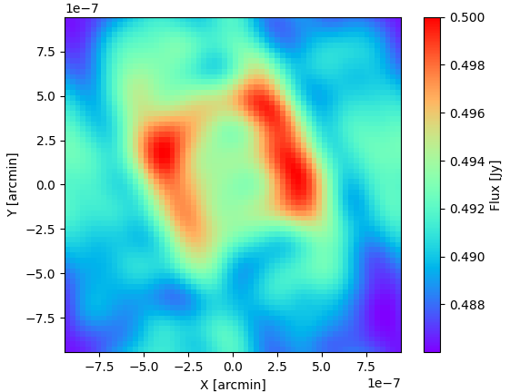

# Space VLBI Simulations

### Exploring radio interferometry beyond Earth with OmniUV

**Undergraduate research by Guzmán Grande González · BSc in Physics, Universidad Complutense de Madrid · 2024–2025**

[Getting started](scripts/README.md) · [Understanding the results](results/README.md) · [Read the internship report](docs/internship-report.pdf)

What changes when a radio telescope joins an interferometer from Earth orbit, lunar orbit, or a Lagrange point? This project explores how observing frequency, station geometry and observing schedules affect the structures that a space–ground radio array can distinguish.

Developed during an internship at the **Observatorio Astronómico Nacional (OAN), Instituto Geográfico Nacional (IGN)**, the work uses **OmniUV** to model observations involving ground and space stations, with particular interest in configurations involving SKA-like ground elements. The examples connect array design to three tangible products: **UV coverage, the synthesized beam, and simulated images**.

> **Start here:** the [scripts guide](scripts/README.md) explains the local Ubuntu/WSL environment and PNG/TXT inputs. The [results guide](results/README.md) explains what the figures show and how to compare them. The Spanish-language report contains the original internship narrative and selected results.

*A jet brightness model from the internship report, Figure 1. The displayed interpolation helps visualize the input model; it is not an interferometric reconstruction.*

## Why VLBI—and why put an antenna in space?

**Very Long Baseline Interferometry (VLBI)** combines radio signals recorded at widely separated telescopes. After correlation, each pair of stations measures a complex visibility: information about the sky brightness on a particular angular scale and orientation. Earth rotation and station motion change those samples with time, tracing out the **UV plane**.

The characteristic angular scale improves approximately as

$$\theta \sim \frac{\lambda}{B_\perp},$$

where $\lambda$ is the observing wavelength and $B_\perp$ is a projected baseline perpendicular to the source direction. Shorter wavelengths and longer projected baselines probe finer structure. Actual image quality also depends on sensitivity, sampling, weighting and calibration.

**Space VLBI (SVLBI)** extends baselines beyond the size of Earth. An orbiting antenna can sample spatial frequencies inaccessible to a ground-only array. This creates opportunities to study compact active galactic nuclei and jet structure, while raising practical questions: are enough baseline orientations sampled, is the source detectable, and how much structure survives the incomplete coverage?

The SKA connection adds a complementary motivation: very sensitive ground elements can help observations on demanding space–ground baselines. In this repository, SKA-related station parameters are **simulation assumptions**, not a claim that the complete SKA is participating in the simulated observations.

## A field moving forward

*Context checked on 11 October 2026. These developments provide background; the scripts preserve the internship's scenario assumptions unless explicitly edited.*

| Development | Why it matters here |
|---|---|
| **LOVEX on QueQiao-2** | The spacecraft launched on 20 March 2024. The LOVEX status paper reports in-flight space–ground fringe detections for quasar AO 0235+164 and the Chang'E-6 orbital module, using a lunar-orbit platform. LOVEX has therefore progressed beyond a mission proposal. This does not make every `lovex`-named script an operational mission model. |
| **The European VLBI Network (EVN)** | The EVN brings together widely separated radio telescopes, with correlation and support provided by JIVE. It provides the ground-network context for thinking about sensitivity and baseline coverage. EVN operation and LOVEX's reported demonstration should not be read as evidence of a routine combined service. |
| **SKAMPI and VLBI** | A June 2026 preprint reports S-band fringe detections and early VLBI results with the SKA-Mid dish demonstrator and the EVN, LBA and VLBA. This is a concrete integration milestone for a demonstrator, rather than commissioning of the full SKA for VLBI. |

Sources: [LOVEX status paper](https://arxiv.org/abs/2507.16317), [EVN](https://www.evlbi.org/), [SKAMPI VLBI paper](https://arxiv.org/abs/2606.26940).

## What this project contributes

This repository brings together the scientific work from the internship and its adaptation to a local Python workflow:

- **Scenario construction:** collecting and implementing mission geometry, observing bands, station properties and observing schedules to explore different space–ground arrays.
- **Source-model preparation:** adapting both raster PNG images and TXT lists of positions and flux densities into source models usable by OmniUV.
- **Comparative analysis:** examining UV coverage, point spread functions and dirty images to understand how geometry and frequency influence angular resolution and image structure.
- **An exploratory Lagrange-point configuration:** studying stations associated with the Earth–Sun L2 and Earth–Moon L2 regions, alongside ground stations. This is a numerical concept study, not a validated flight mission or a complete halo-orbit design.
- **Reusable local scripts:** moving simulation cells out of Google Colab, replacing Drive-specific paths, adding input checks and organizing outputs by scenario and run in the adapted wrappers.

**OmniUV itself was developed by Lei Liu and collaborators.** My contribution is the internship's scenario work, source adapters, analysis and local adaptations built on that toolkit. The report discusses the work in the context of a prospective SKA Science Book contribution; it does not establish a published chapter or publication outcome.

## How the simulations work

[OmniUV](https://github.com/liulei/omniuv) is a Python toolkit for simulating VLBI observations with ground and space stations. Its task, station and source objects provide the framework used by these scripts. See the [OmniUV paper](https://arxiv.org/abs/2201.03797) for the toolkit's methods and capabilities.

In this project's scripts, the source adapter assigns angular positions and intensities to image elements. The observation setup selects stations, frequencies, timing and relevant sensitivity parameters. OmniUV then supplies the simulated observation products used for the comparisons. Some scripts explicitly add visibility noise; this must be checked for each scenario.

The displayed reconstructions are **dirty images**: they retain the effects of incomplete sampling and the synthesized beam. These scripts do not establish a CLEAN-based, calibrated science-imaging pipeline.

## A look at the original results

| SLFRO-inspired example | Exploratory L2 example |
|---|---|
|  |  |

*Figures 7 and 8 from the report. Inspect the axis scales before comparing: coverage extending farther from the origin can probe smaller angular scales, but gaps and directional imbalance still affect imaging.*

| PNG-derived source | Simulated dirty image |
|---|---|
|  |  |

*Figures 4 and 6 from the report's 5 GHz L2 demonstration. The input is an illustrative ring template. Applying it at a chosen frequency does not establish a physically calibrated M87 model at that frequency, nor prove that the black-hole shadow would be observable.*

The central lesson is that **long baselines and useful imaging coverage are different requirements**. A nominal resolution estimate alone does not show that an array can faithfully reconstruct the source. See the [results guide](results/README.md) for units, normalization and comparison pitfalls.

## Repository map

| Location | Purpose |
|---|---|
| `omni-uv/` | Local OmniUV copy, its supporting code and required resources. Keep its upstream attribution and licence. |
| `data/` | User-supplied source models: TXT tables and PNG images. |
| `scripts/Jet/` | Jet-related examples. |
| `scripts/SMBHM87/` | M87/ring-related examples; individual models may be illustrative. |
| `scripts/scenarios/` | Additional station configurations and mixed-input examples. |
| `scripts/changes/` | Adaptation notes or change records, when supplied. |
| `results/` | Selected outputs and per-run folders; see its README. |
| `docs/internship-report.pdf` | Original Spanish-language internship report, supplied unchanged. |
| `docs/images/` | Figures extracted from the report and facility photos added for documentation. |
| `.venv/` | Local Python environment, generated on each computer and excluded from version control. |

Folder names are case-sensitive in Ubuntu: `Jet` and `SMBHM87` must keep their capitalization. Use the file listing in your checkout to locate a specific script.

## Read the report as a companion to the code

**[Download the internship report — “Interferometría espacial con SKA”](docs/internship-report.pdf)**

The report explains the academic and institutional context, objectives, modelling approach, selected comparisons and learning outcomes. It is an archival account of the internship, rather than a complete parameter file for every script in this repository.

| PDF page | What to look for |
|---|---|
| 3–4 | Motivation, objectives and host institution. |
| 5–6 | Simulation methodology and PNG/TXT source preparation. |
| 7 | Mission overview and the report's tabulated resolution estimates. |
| 8 | Jet example: input model, dirty beam and reconstructed image. |
| 9 | Ring/L2 example and UV-coverage comparisons. |
| 10–11 | Conclusions and internship experience. |

Page numbers refer to the PDF viewer, including the cover and institutional template page. Figure 3 repeats the dirty-beam wording in its caption; the surrounding discussion presents it as the jet reconstruction. Treat reported numerical values as historical results and verify parameters, units and baseline definitions before using them quantitatively. Current script defaults can differ from the report's illustrated runs.

For a useful reading sequence: read the objectives, choose a figure or scenario, inspect the corresponding script's setup, then use the results guide to interpret a new run. Preserve the exact script and input used if you want to compare an output with the report.

## OAN and Yebes: the research environment

The internship took place within the OAN/IGN research environment. The [Yebes Observatory](https://rt40m.oan.es/) connects radio astronomy, VLBI observing and receiver technology. Its 40 m telescope is used for both single-dish and interferometric observations; [IGN's facility description](https://astronomia.ign.es/en/web/guest/icts-yebes/servicios-radiotelescopio-40m) gives further context.

*OAN facilities. Photo credit: to be added with the selected photograph.*

*Yebes Observatory. Photo credit: to be added with the selected photograph.*

<!-- Publication note: the two facility photographs were not present among the supplied attachments. Add them at the paths above and replace the provisional credits before publishing. The report figures are already included. -->

## Acknowledgements

I would like to express my sincere gratitude to my supervisor, **Cristina García Miró** ([c.garciamiro@oan.es](mailto:c.garciamiro@oan.es)), for her generous support, guidance and encouragement throughout the internship. Her help was fundamental to developing this work and deepening my understanding of radio interferometry.

I also warmly thank the people of the **Observatorio Astronómico Nacional** and the **Yebes Observatory** for their welcome, their willingness to share their expertise, and the opportunity to learn in a research environment where astronomical questions and instrumentation meet.

Finally, I acknowledge the developers of **OmniUV**, whose work provided the simulation framework on which these studies are based.

## References and reuse

- Liu, L., Zheng, W., Fu, J. & Xu, Z. (2022), *OmniUV: A Multi-Purpose Simulation Toolkit for VLBI Observation*, AJ 164, 67. [Paper](https://arxiv.org/abs/2201.03797) · [Code](https://github.com/liulei/omniuv).
- Hong, X. et al., *Lunar Orbital VLBI Experiment: motivation, scientific purposes and status*. [2025 preprint / 2026 journal reference](https://arxiv.org/abs/2507.16317).
- Wongphechauxsorn, J. et al. (2026), *VLBI with SKAMPI, the SKA-Mid MPIfR dish demonstrator*. [Preprint](https://arxiv.org/abs/2606.26940).
- [European VLBI Network](https://www.evlbi.org/) · [Yebes 40 m telescope](https://rt40m.oan.es/).
- Grande González, G. (2024–2025), *Interferometría espacial con SKA*. [Undergraduate internship report](docs/internship-report.pdf), Universidad Complutense de Madrid.

If you build on the simulations, acknowledge both the internship work and OmniUV, and identify the particular script, revision and input model used. OmniUV is distributed under its upstream GPL-3.0 licence; retain the relevant notices. This README does not assign a new licence to the student's code, report or third-party images. Source-image provenance and permissions should accompany any published image assets.
